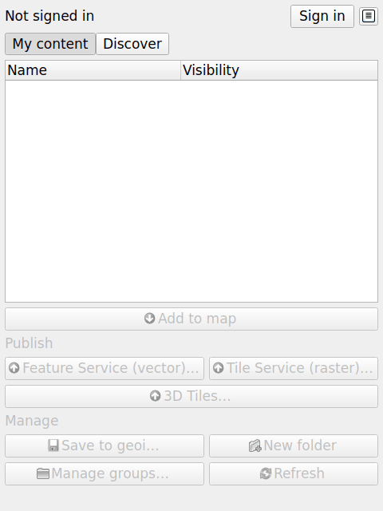
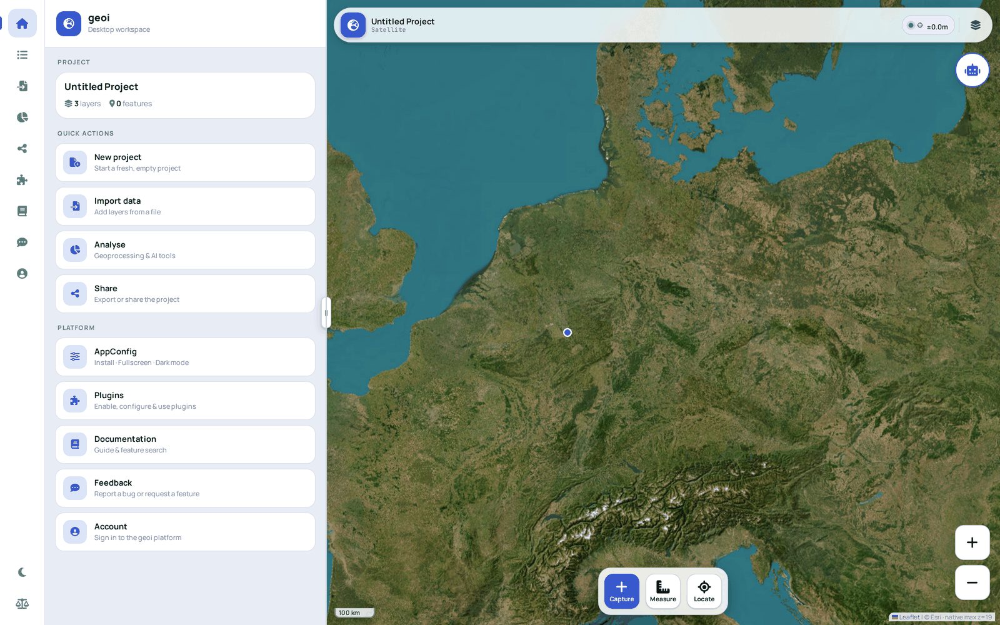

<p align="center">
  
</p>

<h1 align="center">geoi — QGIS plugin</h1>

<p align="center">
  Publish QGIS layers and projects to your own <a href="https://www.geoi.de">geoi</a>
  web GIS in one click — and bring the platform's content back into QGIS as native layers.
</p>

<p align="center">
  <a href="LICENSE"></a>
  
  <a href="https://github.com/geoinformatic/geoi-qgis/releases/latest"></a>
</p>

---

The plugin connects QGIS to a geoi platform — [geoi.de](https://www.geoi.de) or
your own self-hosted server. It is intentionally small and **dependency-free**
(Python standard library + the QGIS API only; the one bundled component, a
pure-Python PMTiles writer, is vendored), and it runs unchanged on QGIS 3.22 LTR
through QGIS 4.x, Qt5 and Qt6.

## Screenshots

| The geoi panel in QGIS | The published result in the web app |
|---|---|
|  |  |

## Features

- **Publish vector layers as a Feature Service.** Pick layers, choose the
  service's visibility (private, shared with a group, or public) and whether its
  features are editable, and publish. A per-layer summary (name, symbology,
  labels, feature count) is shown before anything is sent.
- **Publish projects — symbology carries over to web rendering.** Save the
  current project to the platform as a geoi project ("geoi package"): single,
  categorized and graduated renderers, labels, opacity, outlines and layer
  names are translated to the geoi style model, so the map renders the same in
  the web app.
- **Publish raster as cloud-native tiles.** Tile raster layers or a folder of
  GeoTIFFs into a single PMTiles archive (WebP with overviews, always Web
  Mercator / EPSG:3857) and publish it as a Tile Service. The archive uploads
  directly to object storage via a presigned URL, with live progress and cancel
  in the QGIS task manager. Requires GDAL 3.8+ (bundled with QGIS); the PMTiles
  writer is bundled, and a native `pmtiles` CLI is used automatically if present.
- **Publish point clouds as 3D Tiles.** Publish LAS / LAZ / PLY files as 3D
  Tiles Services, choosing per file whether to reproject to WGS 84 or keep
  local coordinates. Add a 3D-Tiles service to the map as a native layer
  (QGIS 3.34+) or open it in the deck.gl / Cesium web preview.
- **Browse and add content.** A dockable panel lists your services, web maps,
  tile services and 3D-Tiles services, organised by your folder hierarchy.
  Double-click a feature service to add it through QGIS's native ArcGIS Feature
  Service provider (server-side queries, correct CRS, automatic bearer
  authentication for private services); tile services are added as WMTS layers
  or via their XYZ / WMTS / PMTiles URLs.
- **Edit and save back.** An editable feature service round-trips: toggle
  editing in QGIS, change geometry or attributes, save — the changes are
  written back to the platform.
- **Discover public content.** Switch the panel to Discover mode to live-search
  the platform's publicly shared content alongside your own.
- **Organise, share, manage groups.** Rename inline, drag into folders, share
  with groups or publicly (multi-select to share several items at once), toggle
  a service editable/read-only, and create or manage groups and their members —
  all from the panel.
- **One-click sign-in, zero configuration.** Sign-in reuses your platform's own
  web sign-in in the system browser (whichever providers the server offers —
  Google, Apple, Microsoft or ArcGIS) over a loopback handoff. No OAuth client
  to register, no API key to paste.

## Installation

**QGIS plugin manager** (recommended): in QGIS open *Plugins → Manage and
Install Plugins…* and search for **geoi**.

**From ZIP:** download `geoi.zip` from the
[latest release](https://github.com/geoinformatic/geoi-qgis/releases/latest),
then *Plugins → Manage and Install Plugins → Install from ZIP*.

**From source:**

```bash
git clone https://github.com/geoinformatic/geoi-qgis.git
cd geoi-qgis
bash scripts/package.sh     # builds dist/geoi.zip
```

Install the built `dist/geoi.zip` via *Install from ZIP* as above (or copy the
`geoi/` folder into your QGIS profile's `python/plugins/` directory).

## Quick start

1. Click the **geoi** toolbar button (or *Web → geoi → geoi*) to open the panel.
2. Click **Sign in** — your browser opens the platform's sign-in page; pick a
   provider and you are back in QGIS, signed in.
3. **Double-click** a service in the panel to add it to the map as a native
   layer.
4. Click **Publish as Feature Service (vector)** to publish the current layers,
   or **Save to geoi…** to store the whole project with its symbology.
5. Open the result on [www.geoi.de](https://www.geoi.de) (or your own server) —
   it renders the same as in QGIS.

## Configuration

There is almost nothing to configure:

- **Server URL** — the panel's **Server settings** button sets the platform URL
  (defaults to `https://www.geoi.de`). Point it at your own server if you
  self-host geoi. Set it *before* signing in.
- **Token** — you never handle one manually. Signing in obtains a 30-day
  session token, which is stored encrypted in the QGIS authentication database
  (`QgsAuthManager`) and injected as an `Authorization: Bearer` header — never
  written into a layer URL or a log message. **Sign out** removes it.

## Compatibility

| | |
|---|---|
| QGIS | 3.22 LTR through 4.x (`qgisMinimumVersion=3.22`, `qgisMaximumVersion=4.99`), Qt5 and Qt6 |
| Python dependencies | none beyond the standard library and the QGIS API |
| Raster tiling | GDAL 3.8+ (bundled with QGIS) |
| Native 3D-Tiles layers | QGIS 3.34+ (older versions are pointed to the web preview) |

## Development

```bash
git clone https://github.com/geoinformatic/geoi-qgis.git
cd geoi-qgis

# unit tests — pure modules, no QGIS install needed
python3 -m unittest discover -s tests -p 'test_*.py'

# lint
flake8 --max-line-length=100 --extend-ignore=E203,W503 geoi tests

# security scan (plugins.qgis.org runs the same gate on upload)
bandit -r geoi

# editing round-trip against a live local platform (needs php + a QGIS python)
bash tests/e2e/run.sh

# build the installable zip
bash scripts/package.sh     # -> dist/geoi.zip
```

The pure-logic modules import nothing from QGIS, so the unit tests run on any
Python 3. CI additionally imports the plugin under QGIS 3.28 / 3.34 / latest
(Qt5 and Qt6), verifies the PyQGIS API the plugin relies on, and runs the tests
under the QGIS Python — see `.github/workflows/ci.yml`.

### Project layout

| Path | Contents |
|---|---|
| `geoi/` | The plugin package (`metadata.txt`, `plugin.py` entry point) |
| `geoi/gui/` | Dock panel and dialogs (the only QGIS/Qt-touching UI code) |
| `geoi/geoi_client.py`, `auth.py`, `convert.py`, `content_tree.py`, `style.py`, `raster.py`, `pointcloud.py`, `tiles3d.py`, `tiles3d_encoder.py` | Pure logic — no QGIS imports, unit-tested |
| `geoi/_vendor/pmtiles/` | Vendored PMTiles writer (third-party, BSD-3-Clause) |
| `tests/` | Unit tests for the pure modules |
| `tests/e2e/` | Headless-QGIS editing round-trip against a local platform |
| `scripts/` | `package.sh` (build the zip), `verify-release-urls.sh` |
| `docs/` | plugins.qgis.org listing copy, screenshots |
| `.github/workflows/` | CI, release, plugins.qgis.org publishing |

## Contributing

Contributions are welcome — see [CONTRIBUTING.md](CONTRIBUTING.md) for the
ground rules (no third-party dependencies, QGIS 3 and 4 support, lazy QGIS
imports) and the PR conventions, and our
[Code of Conduct](CODE_OF_CONDUCT.md). To report a vulnerability privately,
see [SECURITY.md](SECURITY.md).

## License

[AGPL-3.0](LICENSE) — you may use, modify and redistribute the plugin freely,
but if you distribute a modified version or run one as part of a network
service, you must make its source available under the same license. "geoi" is a
product name and trademark of geoinformatic; the license covers the source
code, not the name or logo. The bundled PMTiles writer
(`geoi/_vendor/pmtiles/`) is third-party code under BSD-3-Clause — see
[NOTICE](NOTICE).

## Links

- geoi web platform: [github.com/geoinformatic/geoi](https://github.com/geoinformatic/geoi)
- geoi hosted service: [www.geoi.de](https://www.geoi.de)
- Issue tracker: [github.com/geoinformatic/geoi-qgis/issues](https://github.com/geoinformatic/geoi-qgis/issues)
